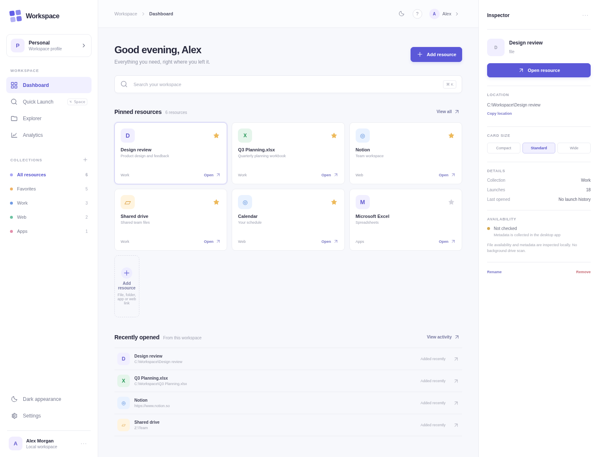
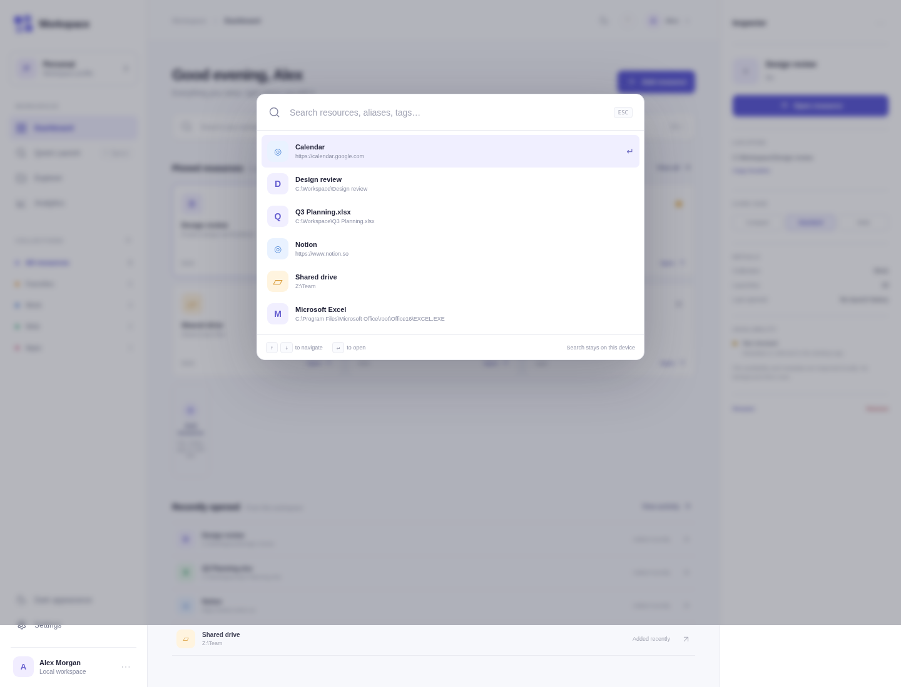

<div align="center">

# Smart Workspace Launcher

**Your files, apps, and links. One workspace.**

A fast, customizable Windows desktop launcher that brings your everyday resources together — with a visual dashboard, instant search, an optional Dock, and useful file activity insights.

[](https://github.com/treborygan/smart-workspace-launcher/issues)


[Overview](#overview) · [Features](#features) · [Preview](#preview) · [Development](#development) · [Roadmap](#roadmap) · [Contributing](#contributing)

</div>

> [!IMPORTANT]
> **Pre-release software.** Development is underway, but there is no verified Windows V1 download yet. Native Windows acceptance tests and release packaging remain outstanding. See [current progress](backlog/STATUS.md) and [Releases](https://github.com/treborygan/smart-workspace-launcher/releases).

## Overview

**Smart Workspace Launcher** is a local-first workspace for opening and organizing files, folders, applications, and websites. Instead of choosing between a traditional shortcut grid and a keyboard launcher, it combines three connected ways to work:

| Dashboard | Quick Launch | Floating Dock |
|:---|:---|:---|
| Arrange shortcuts in a resizable, drag-and-drop workspace. | Find and launch resources using a global hotkey and keyboard search. | Keep your most important shortcuts within reach in an optional, customizable Dock. |

All interfaces are designed to share the same resources, profiles, and launch history.

## Features

- **One place for your shortcuts** — register documents, folders, programs, network paths, and web links; use Windows' default handlers when launching them.
- **Personalized dashboard** — arrange resource cards, organize categories, and work with light or dark themes and configurable appearance.
- **Keyboard-first search** — quickly find saved resources using names, aliases, and relevant matches.
- **Optional floating Dock** — pin frequent resources and access them without opening the main dashboard.
- **Local profiles** — maintain separate workspaces, layouts, and preferences, with portable profile import/export as a V1 goal.
- **Resource details and activity** — inspect available file metadata and application-recorded launches, including recent activity and counts.
- **Local-first operation** — SQLite-based storage, with core functionality designed to work offline and without a cloud account.

> Features are at different stages of implementation. This is the **product scope**, not a claim that every function is fully tested or released. See the [implementation status](backlog/STATUS.md) for verified progress.

## Preview

Development screenshots from the Linux frontend preview. Final Windows appearance and behavior may differ.

| Workspace dashboard | Quick Launch |
|:---:|:---:|
|  |  |

## Development

### Tech stack

| Layer | Technology |
|---|---|
| Desktop shell | Tauri 2 |
| Interface | React + TypeScript |
| Native services | Rust |
| Local persistence | SQLite |
| Target platform | Windows 11 x64 |

### Run from source

You will need **Node.js**, **Rust**, and the [Tauri system prerequisites](https://v2.tauri.app/start/prerequisites/) for your development platform. Native Windows development additionally requires the appropriate Microsoft build tools and WebView2 runtime.

```bash
git clone https://github.com/treborygan/smart-workspace-launcher.git
cd smart-workspace-launcher
npm ci
npm run dev
```

Frontend checks:

```bash
npm run typecheck
npm test
npm run frontend:build
```

On Windows, project scripts are provided for local verification and packaging:

```powershell
.\scripts\verify.ps1
.\scripts\build-windows.ps1
```

**Building locally does not establish release readiness.** Default-app launching, hotkeys, tray behavior, Dock placement, display scaling, and portable execution require real Windows acceptance testing.

## Roadmap

| Milestone | Focus |
|---|---|
| **V1.0 — Essential workspace** | Connected Dashboard, Quick Launch, Dock, resource management, profiles, themes, and basic analytics |
| **V1.1 — Smarter workflows** | Dynamic shortcuts, launch sequences, advanced usage insights, and resource relationships |
| **V1.2 — Greater customization** | Imports, intelligent shortcut maintenance, widgets, and device-specific paths |
| **V2.0 — Extensible platform** | Permissioned extensions and optional synchronization, remote access, and AI-assisted organization |

Track progress in the [project roadmap](backlog/ROADMAP.md), [implementation status](backlog/STATUS.md), and [GitHub Issues](https://github.com/treborygan/smart-workspace-launcher/issues).

## Project documentation

- [Product requirements](docs/PRODUCT_REQUIREMENTS.md)
- [Architecture](docs/ARCHITECTURE.md)
- [Data model](docs/DATA_MODEL.md)
- [UI and interaction design](docs/UX_SPEC.md)
- [Security and privacy](docs/SECURITY.md)
- [Testing and release criteria](docs/TEST_AND_ACCEPTANCE.md)
- [Codex development guide](AGENTS.md)

## Contributing

Feedback, bug reports, and feature suggestions are welcome through [GitHub Issues](https://github.com/treborygan/smart-workspace-launcher/issues). For code contributions, please open a focused pull request with test evidence and follow the [PR template](.github/pull_request_template.md).

This repository uses GitHub Issues and pull requests for coordination and local verification scripts for testing. **GitHub Actions are not part of the current workflow.** Please do not submit private documents, credentials, or sensitive company data.

---

<div align="center">
<sub>Built for a simpler, faster, more personal Windows workspace.</sub>
</div>
